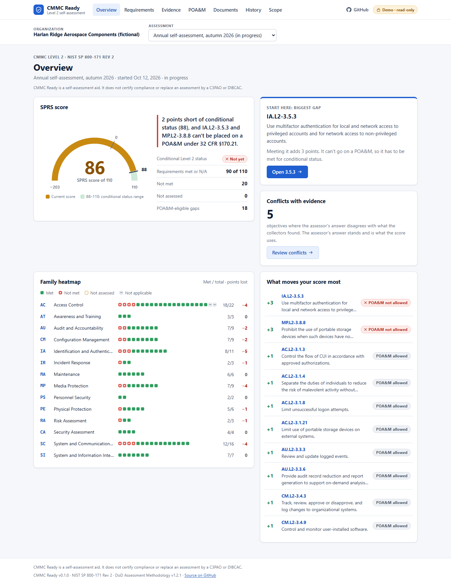
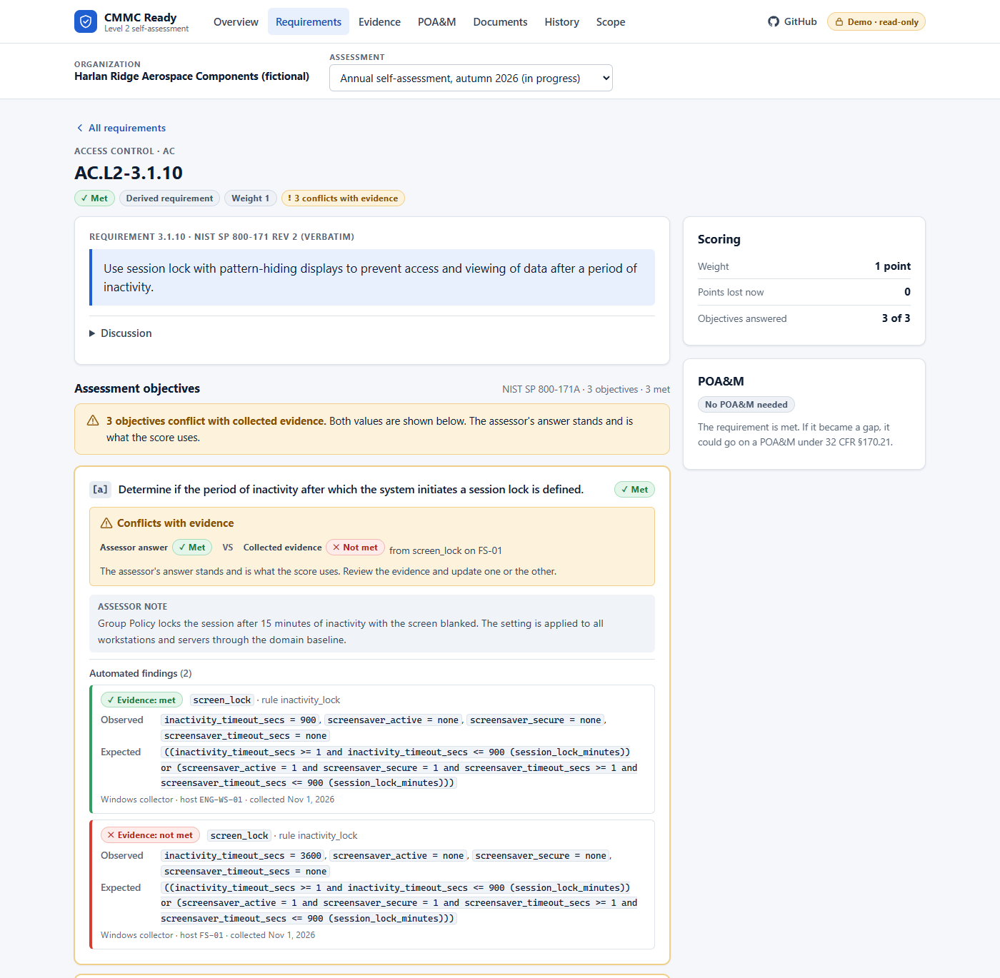
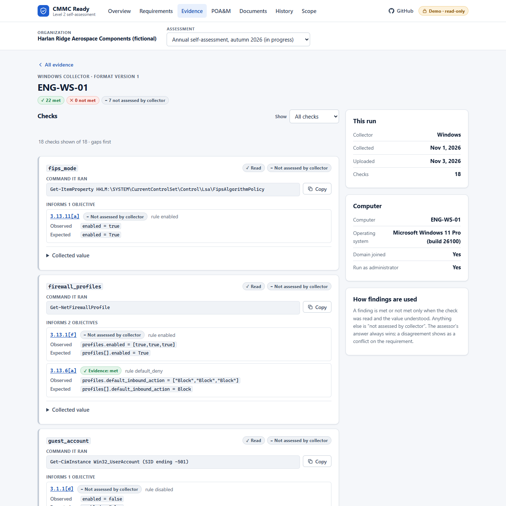
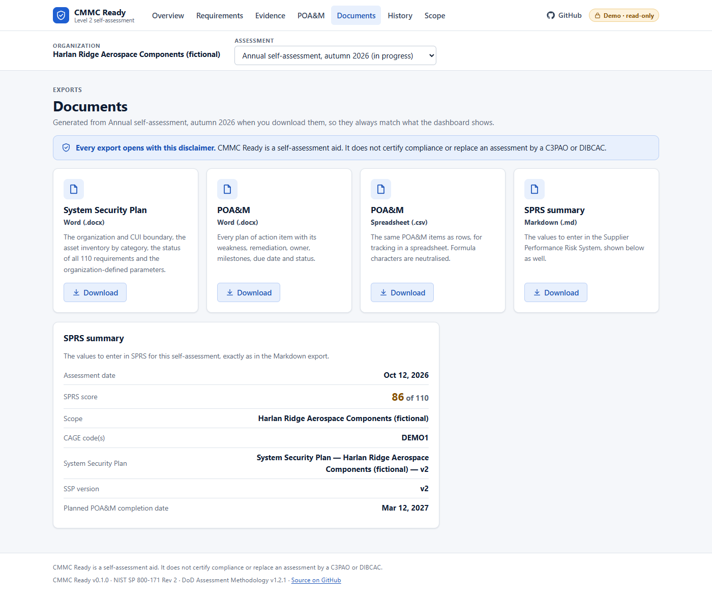
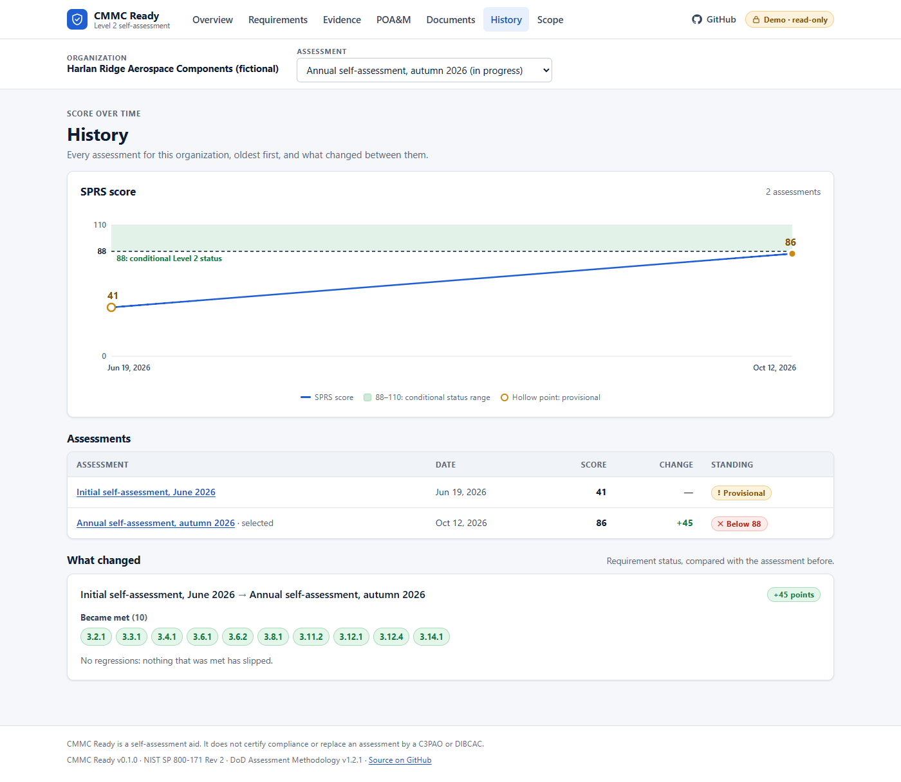
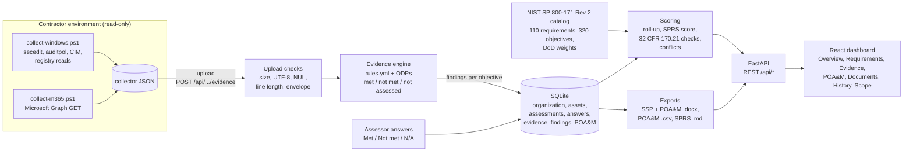

# CMMC Ready

A **CMMC Level 2 self-assessment workbench** for small defense contractors. It walks an organization through all 110 requirements of **NIST SP 800-171 Rev 2** and their 320 SP 800-171A assessment objectives, computes the **SPRS score** exactly as the DoD Assessment Methodology defines it, checks the 32 CFR 170 rules for conditional Level 2 status and POA&M eligibility, and pulls **read-only evidence** from Windows endpoints and Microsoft 365 / Entra ID to put beside the assessor's answers. When the evidence and the assessor disagree, it says so. It produces the System Security Plan, the POA&M and the SPRS summary as documents you can edit.

> **CMMC Ready is a self-assessment aid. It does not certify compliance or replace an assessment by a C3PAO or DIBCAC.** It is not legal advice, and it has no C3PAO workflow.

**Live demo: <https://cmmc-ready.vercel.app/>** (read-only, no password; the company in it is fictional).



## Why CMMC matters now

Defense contractors that handle **Controlled Unclassified Information (CUI)** have long been required to implement the 110 requirements of NIST SP 800-171 and to self-score against the DoD Assessment Methodology, posting the summary score to the Supplier Performance Risk System (SPRS). The **Cybersecurity Maturity Model Certification (CMMC)** program adds verification and makes the result a condition of contract award:

- **32 CFR part 170**, the CMMC Program rule, took effect on **December 16, 2024** (89 FR 83092).
- **The DFARS acquisition rule (48 CFR, DFARS Case 2019-D041)** took effect on **November 10, 2025** (90 FR 43560). That date starts Phase 1: Level 1 and Level 2 self-assessments can be required in applicable solicitations. The requirements phase in over several years; this project relies only on the Phase 1 date, which it checked against the Federal Register text.

So a contractor (or subcontractor) that processes, stores or transmits CUI and bids on a contract naming CMMC Level 2 needs a current, defensible assessment against those 110 requirements, and a plan for the gaps.

**Why Rev 2 and not Rev 3?** NIST withdrew SP 800-171 Rev 2 on May 14, 2024, superseding it with Rev 3. CMMC did not follow: 32 CFR 170.2 incorporates by reference "NIST SP 800-171 R2" (February 2020, with updates as of January 28, 2021) for the Level 2 requirements in 170.14. A Level 2 assessment today checks the Rev 2 requirements and the SP 800-171A objectives, so that is what CMMC Ready implements. Rev 3 is out of scope until the CMMC rule changes.

The sources, the exact wording checked and the places where the original plan was corrected by a source are recorded in [DECISIONS.md](DECISIONS.md).

## The workflow in seven steps

1. **Scope the assessment.** Record the organization, its CAGE codes and the CUI boundary, and list the assets in the CMMC categories (CUI assets, security protection assets, contractor risk managed assets, specialized assets, out of scope). These go into the SSP.
2. **Set the organization-defined parameters.** Minimum password length (default 12), lockout threshold (10 or fewer attempts), session lock (15 minutes or less), password history (24 or more), audit log retention (90 days or more), maximum patch age (35 days) and cloud sign-in frequency (12 hours). Each is shown next to the checks that use it, and changing one re-evaluates every stored finding.
3. **Collect evidence.** Run the [read-only collectors](collectors/README.md) on Windows machines and against the Microsoft 365 tenant, then upload the JSON files. Each check becomes objective-level findings with the observed value, the expected value and the rule's rationale.
4. **Answer the 320 objectives.** For each objective, choose Met, Not met or Not applicable (N/A needs a written justification) and add a note. The collector findings sit beside the question; if they disagree with the answer, the objective is flagged **Conflicts with evidence** and both values are shown. The assessor's answer stands and is what the score uses.
5. **Read the score.** The overview shows the SPRS score, whether it meets the conditional Level 2 threshold, what blocks it, the family heatmap and the gaps that would raise the score most.
6. **Plan the gaps.** Gaps that 32 CFR 170.21 allows on a POA&M become draft items with a due date 180 days after the assessment date. Items carry the weakness, remediation, owner, milestones and status. Gaps that may not be on a POA&M are listed with the reason.
7. **Export and track.** Download the SSP and the POA&M as Word documents, the POA&M as CSV and the SPRS summary as Markdown. Every export opens with the disclaimer. The History page compares assessments over time and lists which requirements became met or slipped.

| Requirement detail with a conflict | Evidence from one Windows host |
|---|---|
|  |  |

| Documents | History |
|---|---|
|  |  |

## Scoring rules

All constants come from the **DoD Assessment Methodology v1.2.1 (June 24, 2020)**, Section 5 and Annex A, and from **32 CFR 170.21**. They live in `backend/data/nist_800_171r2.json` (weights) and `backend/cmmcready/scoring.py` (rules), and the tests pin them.

| Rule | Value | Source |
|---|---|---|
| Starting score | 110; each requirement not met subtracts its weight | Methodology §5 |
| Weights | 5 (44 requirements), 3 (14), 1 (51); 3.12.4 has no value ("NA") | Methodology §5(d), Annex A |
| Score range | 110 down to −203 (weights total 313) | Derived |
| Partial credit, 3.5.3 (MFA) | −3 when MFA covers remote and privileged access but not general users; −5 when not implemented | Methodology §5(e)(i) |
| Partial credit, 3.13.11 (FIPS) | −3 when encryption is used but not FIPS-validated; −5 when not used | Methodology §5(e)(ii) |
| Missing System Security Plan (3.12.4) | The assessment cannot be completed; the score is shown as **provisional** | Methodology §5(g) |
| Conditional Level 2 status | Score ÷ 110 ≥ 0.8, so at least **88** | 32 CFR 170.21 |
| POA&M eligibility | Only requirements weighted 1, except 3.1.20, 3.1.22, 3.10.3, 3.10.4, 3.10.5 and 3.12.4, which may never be on one; plus 3.13.11 when it is at −3 | 32 CFR 170.21 |
| POA&M closeout | Within 180 days | 32 CFR 170.21 |

How objective answers become a score:

- A requirement is **Met** only when every objective is Met or N/A. One Not met objective makes it **Not met**. With nothing answered it is **Not assessed**.
- **N/A** needs a justification and scores as met, which is the methodology's rule. The SSP (3.12.4) cannot be N/A.
- **Not assessed** requirements are deducted at full weight, and the score is labelled provisional until every requirement is answered, so an unfinished assessment never looks better than it is.
- **Conditional Level 2 status** needs all three: a score of at least 88, every remaining gap eligible for a POA&M, and an SSP.
- Collector evidence **never** changes the score directly. It informs the assessor, who decides.

## What the collectors automate, and what stays manual

<!-- coverage:start (generated by `python -m cmmcready catalog --coverage-md --write`) -->
The collectors run 37 rules that inform **37 of the 320 assessment objectives** (in 26 of the 110 requirements). A collector can mark only 23 of those objectives Met. For the rest, a compliant setting is recorded as supporting evidence, because one host or tenant setting does not show that an organization-wide objective is met. The other 283 objectives (policies, training, physical protection, personnel screening, incident response and so on) are answered by the assessor alone.

| Family | Objectives | With collector evidence | Collector can mark Met | Assessor only |
|---|---:|---:|---:|---:|
| 3.1 Access Control | 70 | 15 | 8 | 55 |
| 3.2 Awareness and Training | 9 | 0 | 0 | 9 |
| 3.3 Audit and Accountability | 29 | 2 | 2 | 27 |
| 3.4 Configuration Management | 44 | 1 | 0 | 43 |
| 3.5 Identification and Authentication | 25 | 9 | 7 | 16 |
| 3.6 Incident Response | 14 | 0 | 0 | 14 |
| 3.7 Maintenance | 10 | 0 | 0 | 10 |
| 3.8 Media Protection | 15 | 1 | 1 | 14 |
| 3.9 Personnel Security | 4 | 0 | 0 | 4 |
| 3.10 Physical Protection | 16 | 0 | 0 | 16 |
| 3.11 Risk Assessment | 9 | 0 | 0 | 9 |
| 3.12 Security Assessment | 14 | 0 | 0 | 14 |
| 3.13 System and Communications Protection | 41 | 5 | 2 | 36 |
| 3.14 System and Information Integrity | 20 | 4 | 3 | 16 |
| **Total** | **320** | **37** | **23** | **283** |

Every rule, with the objective it informs and what it may record, is listed in [docs/COLLECTOR_COVERAGE.md](docs/COLLECTOR_COVERAGE.md).
<!-- coverage:end -->

Most of CMMC Level 2 is about policy, process and people, and no script can see those. The collectors cover the technical settings where one machine or one tenant gives honest evidence, and they are deliberately conservative: when a setting supports an objective but cannot prove it organization-wide (a firewall that is on, FIPS mode enabled, four or fewer Global Administrators), the finding is shown as supporting evidence and the objective stays with the assessor.

## Collectors

Both collectors are PowerShell scripts (Windows PowerShell 5.1 or PowerShell 7). They only read: no setting is changed, nothing is written to the registry or the tenant, and no password, secret or token passes through the script or the app. Each check records the exact command it ran, and a check that cannot be read is recorded as unavailable with the reason.

```powershell
# Windows: run elevated for the full set of checks
powershell -ExecutionPolicy Bypass -File .\collectors\collect-windows.ps1 -OutFile windows-evidence.json -RedactNames

# Microsoft 365 / Entra ID: interactive sign-in with four read-only Graph scopes
Install-Module Microsoft.Graph.Authentication -Scope CurrentUser
powershell -ExecutionPolicy Bypass -File .\collectors\collect-m365.ps1 -OutFile m365-evidence.json -RedactNames
```

**Windows** (18 checks) reads the local security policy with `secedit /export /cfg <temp file> /areas SECURITYPOLICY`, audit policy with `auditpol /get /category:* /r`, the Security log with `Get-WinEvent`, and uses `Get-BitLockerVolume`, `Get-NetFirewallProfile -PolicyStore ActiveStore`, `Get-SmbServerConfiguration`, `Get-LocalGroupMember -SID S-1-5-32-544`, `Get-MpComputerStatus`, `Get-HotFix`, `Get-CimInstance` and read-only registry lookups for the rest. The one side effect: `secedit` writes its export to a temp file, which the script deletes at once, and Windows appends a line to `%windir%\security\logs\scesrv.log` whenever `secedit` runs.

**Microsoft 365 / Entra ID** (6 checks) signs in through `Connect-MgGraph` with `Policy.Read.All`, `Directory.Read.All`, `AuditLog.Read.All` and `RoleManagement.Read.Directory`, then makes only `GET` requests: the security defaults policy, Conditional Access policies, the authentication methods policy, directory role definitions and assignments, and one directory audit entry from the last seven days.

The full list of every command and registry path, what the output files contain and how `-RedactNames` works is in **[collectors/README.md](collectors/README.md)**.

## Quick start

Requires **Python 3.12+** and **Node 20.19+ or 22.12+**.

```bash
# 1. Backend: install, load the fictional demo company, start the API on :8000
cd backend
python -m venv .venv
.venv/Scripts/activate            # Windows   (macOS/Linux: source .venv/bin/activate)
pip install -r requirements-dev.txt
python -m cmmcready create-admin  # optional: choose a password so you can sign in and edit (saved to backend/.env)
python -m cmmcready demo --serve

# 2. Frontend (second terminal, from the repo root): dashboard on :5173
npm install
npm run dev
```

Open <http://localhost:5173>. You browse the demo read-only as a guest; if you ran `create-admin`, choose **Sign in** (user `admin`) to answer objectives, upload evidence and edit POA&M items. API docs are at <http://localhost:8000/docs>.

`demo` loads the fictional company into its own database file, `backend/data/demo.db`, so it never touches your real data:

```
Loaded the fictional demo organization into ...\backend\data\demo.db
Organization: Harlan Ridge Aerospace Components (fictional)
  assessment 1: Initial self-assessment, June 2026: SPRS score 41 (provisional)
  assessment 2: Annual self-assessment, autumn 2026: SPRS score 86
```

Run it again and it keeps the existing file; `--reset` reloads it from `backend/data/demo_fixture.json`. `--db PATH`, `--host`, `--port` and `--reload` are also available.

**Your own assessment:** run `python -m cmmcready create-admin`, then `python -m cmmcready serve`. That uses `backend/data/cmmcready.db` (or `CMMCREADY_DB`), starts empty, and the Scope page sets up the organization and the first assessment.

Other commands:

```bash
python -m cmmcready catalog --check                   # validate the catalog: 110 requirements, 320 objectives, weight 313
python -m cmmcready catalog --coverage-md             # print the collector coverage table from rules.yml
python -m cmmcready collect-parse windows out.json    # validate collector output and summarise the findings
```

### Configuration

All settings are environment variables (locally they can live in `backend/.env`, which is git-ignored; see `backend/.env.example`).

| Variable | Purpose |
|---|---|
| `CMMCREADY_ADMIN_USER` | Username (default `admin`) |
| `CMMCREADY_ADMIN_PASSWORD_HASH` | Salted PBKDF2-SHA256 hash (600,000 iterations) written by `create-admin`. The plain password is never stored. |
| `CMMCREADY_SECRET_KEY` | Signs session tokens. At least 32 characters; changing it logs everyone out. |
| `CMMCREADY_COOKIE_SECURE` | HTTPS-only session cookie. On by default; `create-admin` turns it off in the local `.env` for plain-http development. |
| `CMMCREADY_DB` | SQLite file (default `backend/data/cmmcready.db`) |
| `CMMCREADY_DEMO` | Demo mode: loads the fictional company into an empty database and turns guest access on by default |
| `CMMCREADY_GUEST` | Read-only access for anonymous visitors. Default: on in demo mode, off otherwise. |
| `CMMCREADY_TRUST_PROXY` | Read the client IP from `X-Forwarded-For`. Only behind a proxy you control. |
| `CMMCREADY_MAX_UPLOAD_MB` | Upload limit for collector files (default 10) |
| `CMMCREADY_SESSION_HOURS` | Session length (default 8) |

`create-admin --print` prints the variables for a hosting provider instead of writing `.env`.

### Deploying to Vercel

The repo deploys as one Vercel project. Vite builds the dashboard as static files, and `api/index.py` runs the FastAPI backend as a Python serverless function; `vercel.json` routes `/api/*` to it and everything else to the single-page app, bundles `backend/cmmcready/**` (including `evidence/rules.yml`) and `backend/data/**` into the function, and sets the security headers. The root `requirements.txt` is what Vercel installs for the function; a test checks that it matches the backend's runtime dependencies.

Each function instance builds its own SQLite database in `/tmp` from the demo fixture on a cold start, so the hosted site is a self-contained, read-only demo. Anonymous visitors are guests and every write returns 403.

1. In Vercel, choose **Add New → Project**, import the repository and keep the detected defaults (framework Vite, `npm run build`, output `dist`).
2. Under **Settings → General → Node.js Version**, choose 20.x or 22.x (Vite 8 needs 20.19+ or 22.12+).
3. Optional, for an admin login on the hosted copy: run `python -m cmmcready create-admin --print` locally and add `CMMCREADY_ADMIN_USER`, `CMMCREADY_ADMIN_PASSWORD_HASH` and `CMMCREADY_SECRET_KEY` as environment variables. Leave `CMMCREADY_COOKIE_SECURE` unset. Without them nobody can sign in, and the guest view works as normal.
4. Deploy. The dashboard should load without a password and show "Demo · read-only".

`api/index.py` sets the hosted defaults, each overridable in Vercel's settings: `CMMCREADY_DB=/tmp/cmmcready.db`, `CMMCREADY_DEMO=true`, `CMMCREADY_TRUST_PROXY=true` and `CMMCREADY_MAX_UPLOAD_MB=4` (Vercel caps request bodies at 4.5 MB).

## Architecture



| Component | Where | Notes |
|---|---|---|
| Catalog | `backend/data/nist_800_171r2.json`, `backend/cmmcready/catalog.py` | Built by `backend/scripts/build_catalog.py` from NIST's Rev 2 CSV and the SP 800-171A PDF; every correction against the PDF is asserted. `catalog --check` validates counts and weights. |
| Scoring | `backend/cmmcready/scoring.py`, `poam.py` | Status and score are always derived from the answers, never stored. |
| Evidence | `backend/cmmcready/evidence/` | `windows.py` and `m365.py` validate and normalise each collector's output; `engine.py` evaluates `rules.yml` with three-valued logic, so anything unreadable is Not assessed. |
| Storage | `backend/cmmcready/db.py` | SQLite in WAL mode; demo seeding is a single transaction under a write lock. |
| API | `backend/cmmcready/api.py`, `auth.py`, `uploads.py` | Parameterised SQL, allow-listed filters, guest read-only enforcement, upload validation. |
| Exports | `backend/cmmcready/exports.py` | python-docx documents; the disclaimer is the first paragraph of every export. |
| Dashboard | `src/` | React 18, Vite and React Router, hand-drawn SVG charts, light and dark themes. |
| Demo data | `backend/data/demo_fixture.json` | Built deterministically by `backend/scripts/build_demo.py` (CI checks it is current). The company, people and notes are invented; the Windows hosts and the tenant are derived from the synthetic test fixtures. |

## Security

CMMC Ready holds exactly the kind of information an attacker would like (a list of an organization's security gaps), so its own attack surface matters. These are the measures in the code today.

**Authentication.** One admin account. The password is stored only as a salted PBKDF2-SHA256 hash (600,000 iterations) and checked in constant time; wrong usernames and wrong passwords get the same answer. A successful login sets an HS256 JWT (8-hour expiry) in an `httpOnly`, `SameSite=Strict`, `Secure` (by default) cookie scoped to `/api`, so page scripts cannot read it and other sites cannot make the browser send it. Five failed logins from one IP within five minutes lock that IP out (HTTP 429). The API fails closed: without a password hash and a signing key of at least 32 characters it answers 503 rather than running open, unless guest mode is on. Forged, expired and `alg: none` tokens are rejected (tested).

**Guest mode.** In demo mode, anonymous visitors are a read-only `guest`. Every write (answers, partial-credit choices, ODPs, evidence uploads, POA&M items, organization, assets, assessments) returns 403 for guests, and the tests walk every write route. Outside demo mode guests are off unless `CMMCREADY_GUEST=true`.

**Injection.** All SQL is parameterised. Filter values (family, status) are checked against allow-lists, and the text search is matched in memory, not in SQL. `backend/tests/test_injection.py` sends SQL injection payloads, NUL bytes and oversized strings through every parameter and checks the tables are intact. Request bodies are Pydantic models with length limits. CSV exports neutralise spreadsheet formulas, and characters that are illegal in XML are stripped before writing Word documents.

**Upload validation.** Collector files are checked before they are parsed:

- a request whose `Content-Length` is over the limit (plus 64 KB for multipart overhead) is refused with 413 before any of the body is read;
- the file itself is capped at 10 MB locally and 4 MB on the demo (413);
- NUL bytes or invalid UTF-8 give 415 (a UTF-8 BOM is accepted);
- any line over 65,536 characters gives 413 (pretty-printed collector JSON has short lines; the limit allows for long values);
- invalid JSON, an unknown collector or an unsupported format version gives 400, and a malformed value inside a check can only ever make an objective Not assessed.

**Security headers.** The API and `vercel.json` set the same headers on every response: a Content Security Policy (`default-src 'self'; script-src 'self'; style-src 'self' 'unsafe-inline'; img-src 'self' data:; connect-src 'self'; frame-ancestors 'none'; base-uri 'self'; form-action 'self'`), `X-Content-Type-Options: nosniff`, `X-Frame-Options: DENY` and `Referrer-Policy: strict-origin-when-cross-origin`. A test checks the two copies match.

**Collectors.** Read-only by construction: `secedit /export`, `auditpol /get`, `Get-*` cmdlets, CIM queries, registry reads through `OpenSubKey`, and Microsoft Graph `GET` requests with four `*.Read*` scopes. No credentials are handled by the scripts or stored in the app. The only side effects are `secedit`'s temporary export (deleted at once) and the line Windows adds to `scesrv.log`. `-RedactNames` removes administrator and role-member names from the output.

**Supply chain and CI.** [.github/workflows/ci.yml](.github/workflows/ci.yml) runs the backend tests, `catalog --check`, the collector coverage check and the demo fixture check; the Windows collector under PowerShell 7 and Windows PowerShell 5.1 on `windows-latest`; the frontend tests and build; `npm audit --audit-level=high`; `pip-audit` on `backend/requirements.txt` and the root `requirements.txt`; and a gitleaks secret scan. Dependabot proposes updates for pip, npm and GitHub Actions.

Known advisories: `npm audit` reports 2 moderate advisories in `react-router` / `react-router-dom` 6.x (an open redirect through a backslash in `<Link>` / `useNavigate`, and one in server-side rendering hydration, which this client-only app does not use). The fix needs react-router v7, so they are accepted for now; the app only builds links to its own routes. CI fails only on high severity.

**Secrets.** Secrets live only in environment variables or `backend/.env`, which is git-ignored. `backend/.env.example` holds placeholders only.

**Threat model for the public demo.** The demo shows a read-only view of a fictional company. Its Windows hosts and Microsoft 365 tenant are derived from synthetic fixtures (with a placeholder tenant ID), and no output from a real machine or tenant is in the repository. Guests cannot write, so there is nothing to upload and nothing to deface; each serverless instance has its own throwaway database in `/tmp`; the only secrets that could exist on the server are the optional admin hash and signing key. The worst case from abuse is load on a free-tier function, not exposure of real data, which is why letting anyone in without a password is acceptable there. **A real deployment holds real gap data and must not run like the demo:** set `CMMCREADY_GUEST=false` (the default outside demo mode), keep the admin login, serve it over TLS, and treat the database and exports as sensitive. Not covered today: a login rate limit shared across instances, per-user accounts and roles, an audit log of who changed which answer, and encryption of the database at rest.

## Tests

```bash
cd backend && python -m pytest       # backend
npm test                             # frontend (node:test, from the repo root)
```

There are **384 tests: 352 backend (pytest) and 32 frontend (node:test)**. They cover the catalog against the published counts and weights (110 requirements, 320 objectives, total weight 313); every scoring rule (status roll-up, partial credit, N/A, the provisional score without an SSP, conditional status, POA&M eligibility including the six requirements barred by name); both collectors against compliant, non-compliant and unreadable synthetic output, including the rule that an unreadable check never decides an objective; conflicts between the assessor and the evidence; the POA&M drafts and the exports (each opens with the disclaimer, CSV formulas are neutralised); every API endpoint; guest mode on every write route; upload validation and SQL injection payloads on every parameter; authentication (anonymous requests rejected; forged, expired and `alg: none` tokens rejected; rate limiting; failing closed); the CLI; the committed demo fixture and coverage tables being current; and the Vercel entry point and bundle. The frontend tests cover the overview verdict, the POA&M view logic and the history comparison.

## Limitations and next steps

- **The Microsoft 365 collector has not yet been run against a real tenant.** Its Graph requests follow the v1.0 documentation and its parsing is tested against synthetic responses; the first live run may need adjustments. It is conservative: Conditional Access policies narrowed by location, platform, risk or app subsets leave MFA Not assessed rather than Met.
- **The elevated Windows path is exercised only by the CI job on GitHub's `windows-latest` runner** (a Windows Server image). The non-elevated path has also been run on a Windows 11 workstation. It has not been run across a managed fleet or with real Group Policy baselines.
- **Audit-policy parsing understands English only.** `auditpol` prints settings in the display language; on another language the audit settings stay unknown and the objective stays Not assessed (it fails safe, never Met or Not met).
- **Auditor judgement is still required.** Collectors inform only a small share of the 320 objectives (see the coverage table), and only for the machines and tenant they ran against. Scoping, policies, training, physical security and whether a setting applies everywhere are the assessor's call, and a real CMMC assessment is done by a C3PAO or DIBCAC.
- **Out of scope:** NIST SP 800-171 Rev 3 (not used by CMMC Level 2 today), CMMC Level 3 (NIST SP 800-172), Level 1-only assessments, and any C3PAO workflow.
- **Next:** more collectors (Linux, Intune device compliance, Google Workspace), several tenants and sites in one assessment, per-user accounts with an answer history, and importing a previous SSP.

## Licence

The code is released under the [MIT License](LICENSE), Copyright (c) 2026 Andrew T. Price II.

The NIST SP 800-171 Rev 2 and SP 800-171A text and the DoD Assessment Methodology values in `backend/data/nist_800_171r2.json` are works of the U.S. Government and are not subject to copyright in the United States. They are included with attribution: the file's `source` field cites each publication by title, version, URL and retrieval date. CMMC Ready is not affiliated with or endorsed by NIST or the Department of Defense.
